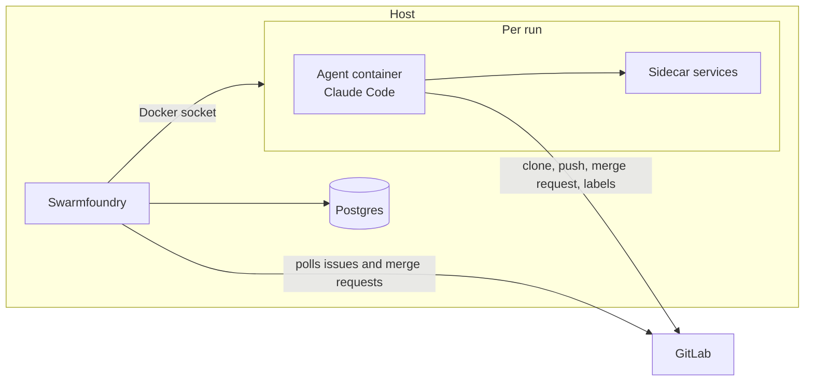

  
  <h1>Swarmfoundry</h1>
  <h3>Turn a GitLab issue board into work for sandboxed Claude Code agents</h3>

Swarmfoundry watches GitLab projects and starts Claude Code agents when issues match your triggers, such as a label
and an assignee. Each agent runs in its own Docker container, clones the project and follows your prompt to do the
work, open a merge request and update the issue. You review and merge.

I built it to let agents work through my backlog unattended, freeing up my time to focus on the bigger picture.
You configure the triggers, prompts, agent settings and sandbox images for your workflow, whether that is
implementation and review, triage or scheduled jobs.

> **Note:** Swarmfoundry is in early development and has not been widely tested. The documentation is still evolving.
> Agents run with Claude's permission checks off inside their sandboxes. Read the [deployment guide](DEPLOYMENT.md)
> before deploying it.

## Features

- Trigger work from issue labels and assignees, merged merge requests or cron schedules in selected projects.
- Run each agent step in a fresh container with CPU and memory limits, configured mounts and sidecar services on a
  private network.
- Check the labels left by a run, retry infrastructure failures and report failed runs on the issue.
- Start one task per matching change. Clear a blocking flag to re-run it.
- Relabel, comment or assign with static steps that need no agent.
- Load config from a local directory or track a repository branch. Each task uses the revision it started with.
- Store tasks, runs and transcripts in Postgres, with configured secrets redacted from stored output and comments.

## How it works

Swarmfoundry polls GitLab, so it needs no inbound webhook access. It copies prompts, settings and instructions into
each container, starts Claude Code and records its output. Agents use `git` and `glab` as a bot user you create.

The [example config](resources/compose/config/README.md) implements issues labelled `workflow::ready`, sends the merge
request to a separate review agent, and leaves merging to a person.

## Planned features

- A web interface to follow tasks, runs and transcripts live, pause triggers, cancel runs and re-run failed tasks.
- Triggers on comments that mention the bot, more merge request events and pipeline results.
- Limits on who can fire a trigger and how many times it runs on one issue.
- An MCP server and API tokens, so agents and scripts can read tasks, runs and transcripts.
- Better permissions and sandboxing for agents.

## Limitations

- Supports only GitLab issues and Claude Code agents.
- Docker socket access gives the orchestrator root-equivalent access to its host. Use a dedicated host.
- Agents can push to any branch the bot can access. Protect your default branch.

## Install

Follow the [deployment guide](DEPLOYMENT.md) to install and upgrade Swarmfoundry with Docker Compose. Start with the
[example config](resources/compose/config/README.md) to define your triggers.

## AI use

I develop Swarmfoundry with AI assistance, including agents run by Swarmfoundry itself, and review every change.

## Contributing

See [CONTRIBUTING.md](CONTRIBUTING.md). Please report security issues privately, as described in
[SECURITY.md](SECURITY.md).

## Licence

Copyright (C) 2026 Louis Collins

Swarmfoundry is licensed under the [GNU Affero General Public License v3.0 only](LICENSE) (`AGPL-3.0-only`).
