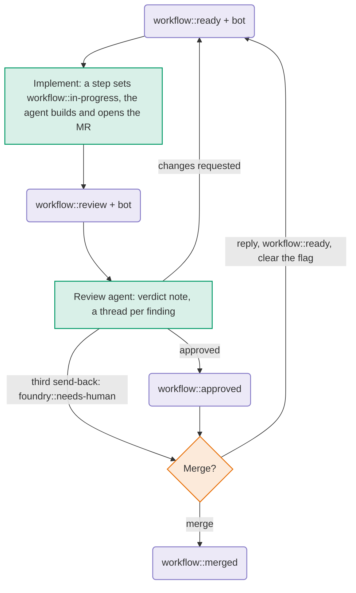

# Example config

One agent implements an issue and opens a merge request, a second reviews it, and a person merges.
[`swarmfoundry.yaml`](./swarmfoundry.yaml) defines the source, agents, environment and triggers.
See the [deployment guide](../../../DEPLOYMENT.md#install) for installation.

## Workflow

The issue's `workflow::` label tracks progress. Agent triggers require the bot to be assigned. Each run records its
findings on the issue or merge request for later runs.

1. A person adds `workflow::ready` and assigns the bot.
2. A static step sets `workflow::in-progress`. The implement agent builds the change, runs checks, opens a merge
   request and sets `workflow::review`.
3. A separate review agent checks the merge request against the issue. It sets `workflow::approved` or opens a thread
   per blocking finding and returns the issue to `workflow::ready`. The implement agent continues the same branch
   and merge request.
4. After two requests for changes, a third review with blocking findings sets `foundry::needs-human`.
5. A person merges. The merged trigger sets `workflow::merged` without starting an agent.

## The board

| Column                  | Meaning                           | Moved here by            | Acts next          |
| ----------------------- | --------------------------------- | ------------------------ | ------------------ |
| `workflow::ready`       | Ready to implement; bot assigned. | A person or review agent | Implement agent    |
| `workflow::in-progress` | Being built.                      | A step before implement  | Implement agent    |
| `workflow::review`      | Built, merge request open.        | Implement agent          | Review agent       |
| `workflow::approved`    | The review passed.                | Review agent             | A person, to merge |
| `workflow::merged`      | Merge request merged.             | The merged trigger       | Nobody             |

The `foundry::` flags track run status separately from the workflow column. Both agent triggers exclude issues
labelled `foundry::needs-human` or `foundry::failed`. Shared `failureSteps` post a failure report and set `foundry::failed`.

| Flag                   | Set by                   | Means                                    | Cleared by                                   |
| ---------------------- | ------------------------ | ---------------------------------------- | -------------------------------------------- |
| `foundry::running`     | A step before each agent | Agent running.                           | A step after the agent, or the failure steps |
| `foundry::needs-human` | Either agent             | Needs a person's input; see the comment. | A person, to re-run; the merged trigger      |
| `foundry::failed`      | The failure steps        | Run failed; see the failure report.      | A person, to retry                           |

## The triggers

Shared rules are in [`instructions.md`](./agents/claude/instructions.md). Each agent's system prompt sets its
boundaries and its prompt defines the steps.

### Implement

Implements the issue and opens a merge request. Later runs continue the same branch and address unresolved threads
opened by the reviewer or bot.

|             |                                                                             |
| ----------- | --------------------------------------------------------------------------- |
| Starts when | An issue enters `ready` with the bot assigned                               |
| Reads       | Issue and comments, open merge request and threads, project documentation   |
| Leaves      | A merge request assigned to `MR_REVIEWER`, with assumptions listed          |
| Labels      | A step sets `in-progress`; the agent sets `review` after finishing          |
| Never       | Merges, closes or creates issues, or pushes outside its own `<iid>-` branch |

`concurrency: 1` limits implementation to one issue at a time.

### Review

Reviews the merge request in a fresh session. Subagents check tests, documentation and, for issues labelled
`security`, security. The main review agent checks the code and pipeline.

|             |                                                                                      |
| ----------- | ------------------------------------------------------------------------------------ |
| Starts when | An issue enters `review` with the bot assigned                                       |
| Reads       | Issue and acceptance criteria, merge request, diff, pipeline and earlier verdicts    |
| Leaves      | A thread per blocking finding and a verdict note starting `Swarmfoundry review:`     |
| Labels      | `approved`, `ready`, or `foundry::needs-human` on the third review requiring changes |
| Never       | Commits, pushes, merges or approves in GitLab. Settings also deny `git push`         |

Verdict notes track requests for changes with `Swarmfoundry review: changes requested (<n> of 2)`.
`Swarmfoundry review: handed to a person` resets the count. Issues implemented by a person stay with a person for
review unless the bot is assigned.

Approval is a workflow label, not a GitLab approval. The same bot identity implements and reviews, using separate
agent sessions. Opening a new merge request resets the requests-for-changes count.

### Merged

When a merge request into `main` merges, this static trigger sets `workflow::merged` on the related issue and clears
`foundry::needs-human`. It uses the `(#<iid>)` suffix in the merge request title, or the single related issue in the
same project reported by GitLab.
